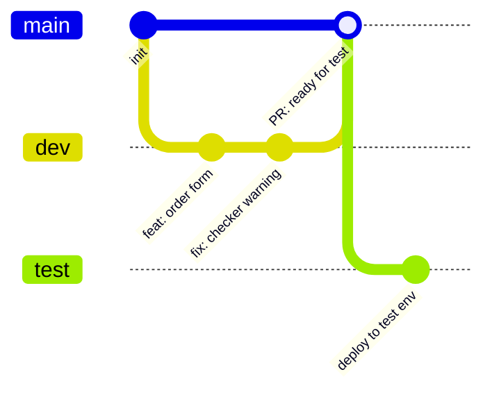

# 06 · CI/CD & Branches — a short read 🌿🚀

*(Supporting material — read this after the workshop. Not a deep dive, just enough to sound smart in your next architecture meeting.)*

## Why branches matter for Power Platform

Power Platform has a quirk compared to "normal" software: **the source of truth lives in an environment, not in Git**. When you export a solution, you take a snapshot. Branching is therefore about **disciplining who changes what, where** — not about merging code lines in the classic sense.

## The classic model: one branch per environment

| Branch | Environment | What happens |
|---|---|---|
| `main` | Source of truth | Only updated via pull request. Protected branch. |
| `dev` | Dev environment | Makers and devs build here. Export & commit often. |
| `test` / `release/*` | Test / UAT | Deployed from CI, never hand-edited. |

**The one rule that makes it work:** never make changes directly in test or prod. Changes flow one way: dev → PR → main → pipeline → test → prod.

## What the CI/CD pipeline does

From your repo's perspective, three stages:

1. **Export** — a scheduled or manually triggered job exports changed solutions from dev, unpacks them, and commits the result (or you do it manually with `pac`, like in Exercise 1).
2. **Build & check** — the pipeline packs the `src/` folder into a managed zip and runs the Solution Checker as a **quality gate**. Red build = no deploy. That's a feature, not a bug.
3. **Deploy** — the managed zip is imported into test (and later prod). People stop being the deploy mechanism.

## Branch rules that save you pain

- **Protect `main`**: no direct pushes, PRs require review and a green pipeline.
- **Small PRs, often**: a solution diff in Git is ugly to review — keep changes bite-sized so reviewers can actually see what happened.
- **Merge before you build long**: long-lived feature branches drift from reality. In low-code, "merge conflicts" show up as lost customizations in the environment.
- **Environments are cheap**: spinning up a dedicated dev environment for a feature beats three makers stepping on each other in one dev environment.

## Where to go deeper

- [Official Power Platform ALM guidance](https://learn.microsoft.com/en-us/power-platform/alm/)
- [Power Platform Actions for GitHub](https://github.com/microsoft/powerplatform-actions) — what the pipeline in this repo uses
- [Power Platform Pipelines](https://learn.microsoft.com/en-us/power-platform/alm/pipelines/get-started-pipelines) — the platform's built-in deployment feature, great for the final hop to prod
- [CoE Starter Kit](https://learn.microsoft.com/en-us/power-platform/guidance/coe/starter-kit-explained) — governance goodies for the ambitious

> **TL;DR:** Build in dev. Commit to Git. Merge via PR. Let the pipeline deploy. Never touch prod by hand — it can't defend itself. 🛡️
